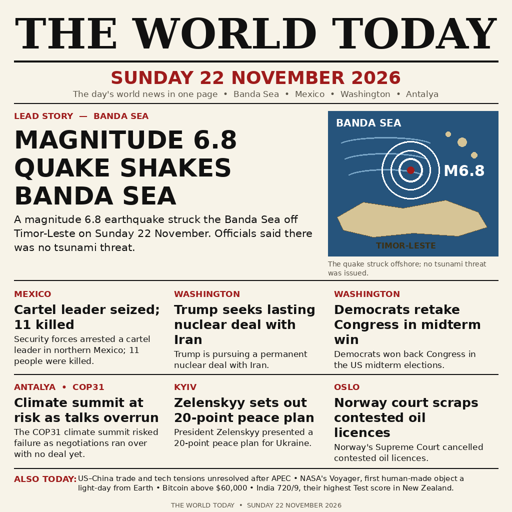

# The World Today — Sunday 22 November 2026

[](https://make.fun/bounty/news-image-20261122?utm_source=github&utm_medium=readme&utm_campaign=news-image-20261122)
[](https://make.fun/bounty/news-image-20261122/leaderboard?utm_source=github&utm_medium=readme&utm_campaign=news-image-20261122)
[](https://make.fun/bounty/news-image-20261122?utm_source=github&utm_medium=readme&utm_campaign=news-image-20261122)

A one-page newspaper front page summing up the world news of
Sunday 22 November 2026, for the make.fun competition
[`news-image-20261122`](https://make.fun/bounty/news-image-20261122)
("Sum up 22 November's world news in one image").



## Stories covered

1. **Banda Sea — Magnitude 6.8 quake.** A magnitude 6.8 earthquake
   struck the Banda Sea off Timor-Leste on 22 November. Officials
   said there was no tsunami threat.
2. **Mexico — Cartel leader seized.** Security forces arrested a
   cartel leader in northern Mexico on 22 November; 11 people were
   killed in the operation.
3. **Washington — Trump seeks lasting nuclear deal with Iran.**
   President Trump is pursuing a permanent nuclear agreement with
   Iran.
4. **Washington — Democrats retake Congress.** Democrats won back
   Congress in the US midterm elections.
5. **Antalya — COP31 climate summit at risk.** The climate summit
   risked failure on 22 November as negotiations ran over with no
   deal yet.
6. **Kyiv — Zelenskyy's 20-point peace plan.** President Zelenskyy
   presented a 20-point peace plan for Ukraine, published over
   21–22 November.
7. **Oslo — Norway court scraps oil licences.** Norway's Supreme
   Court cancelled oil licences challenged on climate grounds.
8. **Also today:** US–China trade and tech tensions unresolved
   after APEC; NASA's Voyager becomes the first human-made object
   a light-day from Earth; Bitcoin rises above $60,000; India post
   720/9, their highest Test score in New Zealand.

## How it was made

The image is drawn from scratch by `main.py` (Python 3 + PIL,
DejaVu fonts, no network, fully deterministic): a masthead naming
the date, one lead story with a shape-drawn map of the Banda Sea
epicentre, six story columns, and an "Also today" strip. No
downloaded or photographic images are used.

## Running

```sh
python3 main.py   # writes entry.png (1024x1024, < 1 MiB) to
                  # $MAKEFUN_OUTPUT_DIR (default /output)
```

## License

MIT — see `LICENSE`.
